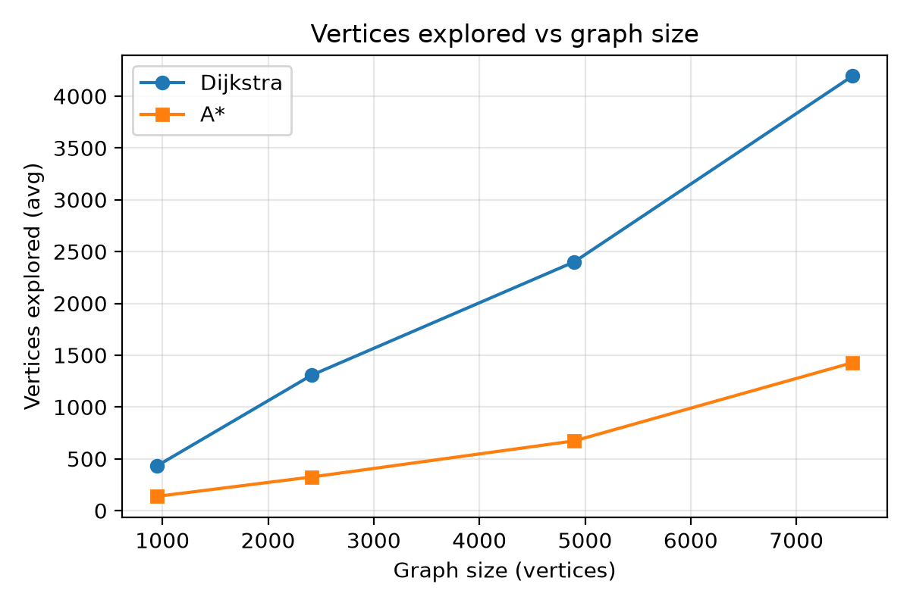
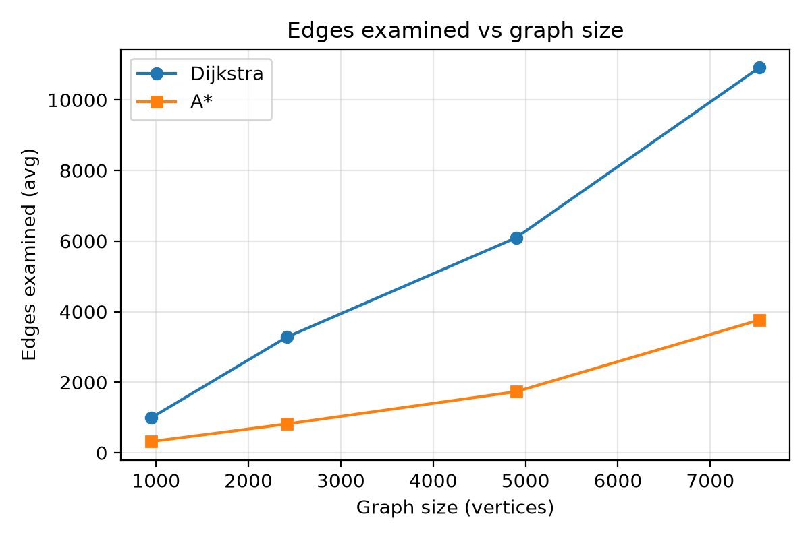
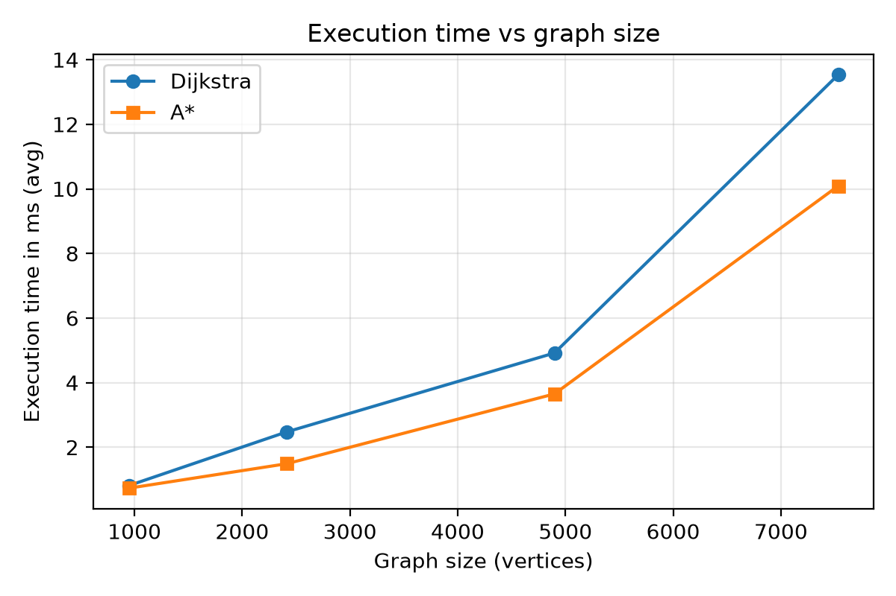
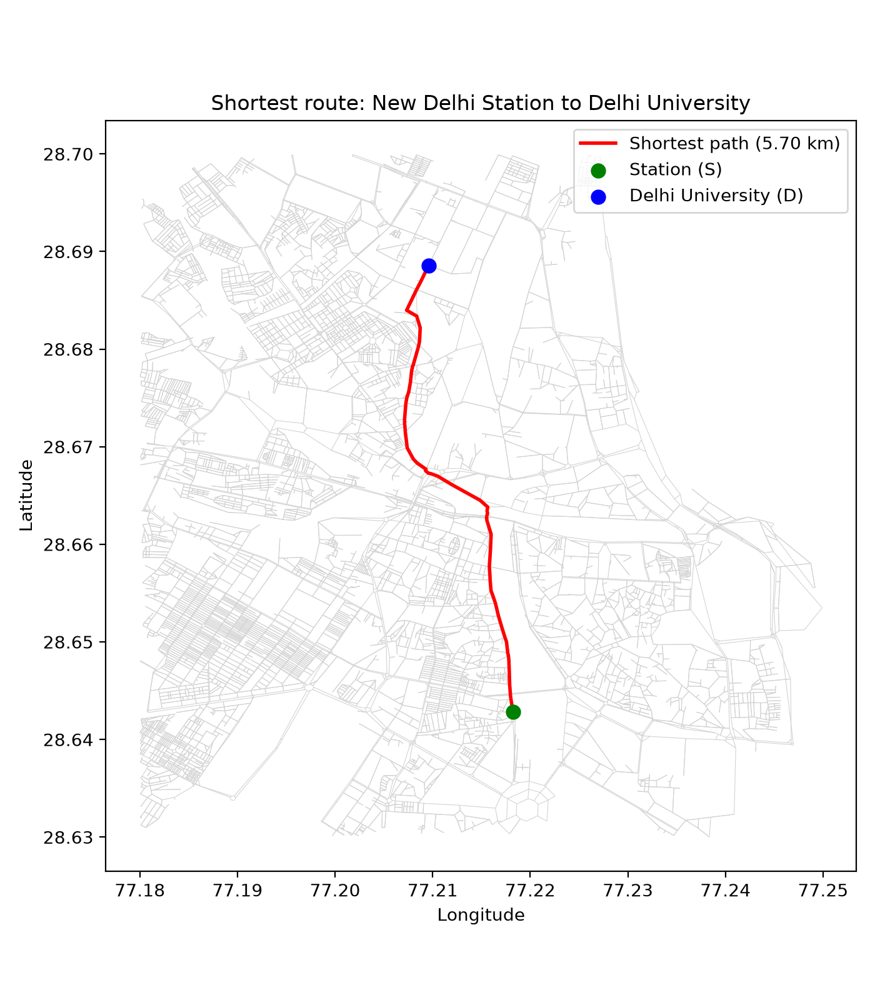

# Shortest Path on a Real Road Network: Dijkstra vs A*

Shortest-path computation from **New Delhi Railway Station** to **Delhi University (North Campus)** on a real OpenStreetMap road network. Dijkstra (min-heap) and A* (haversine heuristic) are implemented from scratch, without built-in shortest-path functions.

## Project Structure

```text
.
├── download_data.py          # downloads the OSM extract (Part A)
├── part_b.py                 # preprocessing + adjacency list + graph statistics (Part B)
├── part_c.py                 # Dijkstra (Part C)
├── part_d.py                 # A* + comparison with Dijkstra (Part D)
├── part_e.py                 # experiments on multiple graph sizes (Part E)
├── results.csv               # Part E results
├── part_plots.py             # plots and route map
├── plot_vertices.png
├── plot_edges.png
├── plot_time.png
├── plot_route.png
├── delhi_station_du.graphml  # saved dataset extract
├── requirements.txt
└── README.md
```

## Setup and How to Run

```bash
python -m venv venv
venv\Scripts\activate            # Windows  (Mac/Linux: source venv/bin/activate)
pip install -r requirements.txt

python download_data.py          # optional: delhi_station_du.graphml is already included
python part_b.py                 # builds graph.pkl and prints graph statistics
python part_c.py                 # Dijkstra
python part_d.py                 # A* and comparison
python part_e.py                 # experiments, writes results.csv
python part_plots.py             # creates the 4 plot images
```

`requirements.txt`:

```text
osmnx==2.1.1
scikit-learn
matplotlib
```

OSMnx is used only to download and read the dataset. All shortest-path logic (Dijkstra, A*, path reconstruction) is implemented manually.

---

## Part A: Dataset

| Item | Details |
|---|---|
| Dataset name | OpenStreetMap drivable road network, New Delhi Railway Station to Delhi University corridor |
| Source | https://www.openstreetmap.org, downloaded through the Overpass API using OSMnx 2.1.1 |
| License / citation | © OpenStreetMap contributors, ODbL, https://www.openstreetmap.org/copyright |
| Description | Real road network of central and north Delhi: intersections and road segments with geometry, length and one-way information |
| Area used | Bounding box (west, south, east, north) = (77.18, 28.63, 77.25, 28.70), `network_type="drive"` |
| Records used | 7,666 nodes and 19,891 edges (raw); 7,531 nodes and 19,560 edges (after preprocessing) |
| Vertex | A road intersection or road end point, with latitude and longitude |
| Edge | A directed drivable road segment between two vertices (one-way roads give a single directed edge) |
| Edge weight | Segment length in meters |

**Why this dataset is suitable:**

- Many students travel from the New Delhi Railway Station to Delhi University, so this route is a realistic use case for a shortest-path algorithm.
- It is a real urban road network with positive edge weights (length), as the problem requires.
- Every vertex has coordinates, so a distance-based A* heuristic can be used.
- Roads are naturally sparse and directed, which is a realistic setting for route planning.
- It is publicly available and reproducible.

**Source and destination:**

- S = nearest graph node to New Delhi Railway Station (28.6431, 77.2197)
- D = nearest graph node to Delhi University North Campus (28.6879, 77.2100)

Nearest nodes are found with the haversine distance.

---

## Part B: Graph Construction

Preprocessing steps:

1. Load the GraphML file (`MultiDiGraph`).
2. Keep only the **largest strongly connected component**, so a path exists between every pair of vertices. This removed 135 nodes (dead-ends and trap regions created by cutting the map at the bounding box).
3. Remove **self-loops**.
4. For **parallel edges** between the same pair of nodes, keep only the minimum length.
5. Keep only what shortest-path computation needs: vertex id, latitude/longitude, and edge length. Road names, types, geometry etc. are dropped.
6. Store the graph as an **adjacency list**: `adj[u] = [(v, weight), ...]`, plus `coords[u] = (lat, lon)`.

| Metric | Value |
|---|---|
| Raw nodes / edges | 7,666 / 19,891 |
| After largest SCC | 7,531 nodes / 19,619 edges |
| **Vertices (final)** | **7,531** |
| **Edges (directed, final)** | **19,560** |
| **Average degree** (out-degree) | **2.6** |
| **Maximum degree** (out-degree) | **5** |

The graph is sparse: E ≈ 2.6 V.

---

## Part C: Dijkstra's Algorithm

Implemented with `heapq` as a min-priority queue. Stale heap entries are skipped using a `done` set. A `parent` dictionary is used for explicit path reconstruction. If the destination is not reached, the function returns "no path" (disconnected pair handling).

Result for Station → DU:

| Metric | Value |
|---|---|
| Shortest-path cost | 5,702.14 m |
| Path length | 70 vertices |
| Vertices explored | 5,935 |
| Edges examined | 15,404 |
| Execution time | ~38 ms |

The complete vertex sequence is printed by `part_c.py`.

**Time complexity:** O((V + E) log V) with a binary heap.

- Each vertex is finalized once, and each edge is examined at most once.
- Each heap push/pop costs O(log V), since the heap holds at most E entries and log E ≤ 2 log V.
- In this graph E ≈ 2.6 V, so it behaves close to O(V log V).

---

## Part D: A* Algorithm

Priority is `f(v) = g(v) + h(v)`, where `g(v)` is the cost from S to v and `h(v)` is the **haversine (great-circle) distance** from v to D, in meters.

**Heuristic justification:**

- **Admissible:** the straight-line distance never exceeds the true road distance, so `h(v)` never overestimates the remaining cost.
- **Consistent:** for every edge (u, v), `h(u) ≤ w(u, v) + h(v)`, by the triangle inequality and because the edge length is at least the straight-line distance between its end points. Hence each vertex is finalized once and A* returns an optimal path.

Result for Station → DU:

| Metric | Dijkstra | A* |
|---|---|---|
| Shortest-path cost (m) | 5,702.14 | 5,702.14 |
| Vertices explored | 5,935 | 734 |
| Edges examined | 15,404 | 1,980 |
| Execution time (ms) | ~38 | ~5.4 |

Both algorithms return the same optimal cost and the same path length (70 vertices). A* explores about 8x fewer vertices and is about 7x faster on this query.

---

## Part E: Experimental Evaluation

**Setup**

- Sub-graphs are taken from the 7,531-vertex corridor graph: BFS from the midpoint of Station and DU, keep the first N vertices (N = 1000, 2500, 5000, all), then keep the largest strongly connected component. Resulting sizes: 949, 2,414, 4,898 and 7,531 vertices.
- 10 random (S, D) pairs per size, `random.Random(42)`. Dijkstra and A* receive the same pairs.
- Values are averages over the 10 queries. The script (`part_e.py`) also checks that both algorithms return the same cost and prints a warning otherwise (no warning appeared). Results are saved in `results.csv`.
- Sizes of 10,000 and above are not possible, because the Station-DU corridor contains only 7,531 vertices.

| Graph Size (V) | Edges | Algorithm | Cost (m) | Vertices Explored | Edges Examined | Time (ms) |
|---|---|---|---|---|---|---|
| 949 | 2188 | Dijkstra | 2153.81 | 432.5 | 994.7 | 0.814 |
| 949 | 2188 | A* | 2153.81 | 137.8 | 321.6 | 0.733 |
| 2414 | 5899 | Dijkstra | 2736.41 | 1308.4 | 3278.1 | 2.476 |
| 2414 | 5899 | A* | 2736.41 | 325.0 | 817.1 | 1.49 |
| 4898 | 12280 | Dijkstra | 4062.66 | 2400.9 | 6095.3 | 4.918 |
| 4898 | 12280 | A* | 4062.66 | 673.1 | 1733.2 | 3.651 |
| 7531 | 19560 | Dijkstra | 5452.16 | 4194.0 | 10915.4 | 13.532 |
| 7531 | 19560 | A* | 5452.16 | 1428.1 | 3765.3 | 10.09 |

| V | Dijkstra explored (% of V) | A* explored (% of V) | Vertex reduction | Time speedup |
|---|---|---|---|---|
| 949 | 45.6% | 14.5% | 3.1x | 1.11x |
| 2,414 | 54.2% | 13.5% | 4.0x | 1.66x |
| 4,898 | 49.0% | 13.7% | 3.6x | 1.35x |
| 7,531 | 55.7% | 19.0% | 2.9x | 1.34x |

### Plots






Notes: every value is an average over 10 queries per size. At the smallest size the times are below 1 ms, so small differences there are partly timer noise. The route map shows the shortest path (5.70 km) found by Dijkstra and A* on the full corridor graph.

---

## Part F: Analysis

**1. Why is the dataset suitable for shortest-path analysis?**
Many students travel from the New Delhi Railway Station to Delhi University, so this route is a realistic use case where a shortest-path algorithm can directly help. The dataset is also technically suitable:
- It is a real urban road network (OpenStreetMap), not a manually created graph. Intersections become vertices and drivable road segments become edges.
- Each segment has a length in meters, giving the positive weight w(u, v) the problem requires.
- One-way roads appear as directed edges, as in real route planning.
- Every vertex has latitude and longitude, so the haversine distance can be used as an admissible A* heuristic.
- After preprocessing it has 7,531 vertices and 19,560 edges, which is large enough to compare Dijkstra and A* and to extract sub-graphs of different sizes.
- It is public and reproducible (© OpenStreetMap contributors, ODbL).

**2. How was the raw dataset transformed into a weighted graph?**
1. OSMnx downloaded the drivable network of the bounding box as a `MultiDiGraph` (7,666 nodes, 19,891 edges).
2. The largest strongly connected component was kept (135 nodes removed), so a path exists between every pair of remaining vertices.
3. Self-loops were removed.
4. For parallel edges between the same pair of nodes, only the minimum length was kept. Steps 3 and 4 removed 59 edges.
5. Only what the algorithms need was kept: vertex id, latitude/longitude, and edge length. Road names, types and geometry were dropped.
6. The result was stored as an adjacency list `adj[u] = [(v, w), ...]` with a separate `coords[u] = (lat, lon)` dictionary.

Final graph: 7,531 vertices, 19,560 directed edges. Removing the 135 vertices does not change shortest paths between the remaining vertices: a removed vertex is outside the largest strongly connected component, so it cannot lie on any path between two vertices of that component.

**3. Do Dijkstra and A* produce the same optimal path cost?**
Yes. For the Station to DU query both gave 5,702.14 m, and in Part E the costs matched on all 40 queries (10 pairs x 4 sizes); the script prints a warning on any mismatch and none appeared. Dijkstra is optimal because it always finalizes the vertex with the smallest g(v). A* stays optimal because its heuristic is admissible: for any vertex v on an optimal path, f(v) = g(v) + h(v) is at most the optimal cost C*, so the destination cannot be finalized with a worse cost before the optimal path is completed.

**4. Which algorithm explores fewer vertices, and why?**
A* explores fewer vertices at every size: about 3x to 4x fewer in Part E (A* explored 13% to 19% of the vertices, Dijkstra 45% to 56%) and about 8x fewer on the Station to DU query (734 vs 5,935). Dijkstra uses only g(v) and expands equally in all directions around S. A* adds h(v), so vertices leading away from D get a large f(v) and are never expanded. Since h(v) >= 0, f(v) >= g(v), so the set of vertices A* expands is a subset of the set Dijkstra expands. The reduction depends on how tight the heuristic is: it is largest when the road is close to a straight line, and smaller for random pairs whose roads detour.

**5. How does execution time vary as the graph size increases?**
Time grows for both algorithms. From 949 to 7,531 vertices (about 7.9x), Dijkstra grew from 0.81 ms to 13.5 ms (about 17x) and A* from 0.73 ms to 10.1 ms (about 14x). The growth is slightly faster than linear because of the log V heap factor, and because random pairs in a larger graph are farther apart, so a larger share of the graph is explored. A* is faster at every size, but its time speedup (1.1x to 1.7x) is smaller than its vertex reduction (3x to 4x), because it computes a haversine distance for every vertex it pushes. Each size uses only 10 queries and the smallest sizes take under 1 ms, so these are trends, not exact ratios.

**6. Effect of the graph's density on shortest-path computation**
The graph is very sparse: density E / (V(V-1)) is about 0.03%, average degree is 2.6 and maximum degree is 5. In Part E the number of edges examined per explored vertex was close to the average degree (2.3 for V = 949 up to 2.6 for V = 7,531), so the work per vertex is small. Because E is about 2.6 V, the running time is dominated by the V log V heap operations. In a dense graph (E close to V^2) every explored vertex would examine many edges and push many heap entries, and the time would approach O(V^2 log V). This is a conclusion from the theory and the edges-per-vertex counts: density was not varied independently in the experiments (the small increase in average degree with size comes from how sub-graphs are cut).

**7. Time complexity of the Dijkstra implementation**
O((V + E) log V) with a binary heap (`heapq`). Each vertex is finalized once and each edge is examined at most once. Each heap push or pop costs O(log V), since the heap holds at most E entries and log E <= 2 log V. Stale heap entries are skipped using a `done` set. For this road graph E is about 2.6 V, so it behaves like O(V log V).

**8. Heuristic used by A*: admissible and consistent?**
h(v) is the haversine (great-circle) distance from v to the destination D, in meters, the same unit as the edge weights.
- Admissible: a road path can never be shorter than the straight line, so h(v) never overestimates the remaining cost.
- Consistent: for every edge (u, v), triangle inequality gives h(u) <= hav(u, v) + h(v), and the edge length w(u, v) >= hav(u, v), so h(u) <= w(u, v) + h(v). Also h(D) = 0.
A consistent heuristic means each vertex is finalized only once, so the `done` set is safe and the first time D is popped the path is optimal.

**9. Difficulties faced while converting the dataset into a graph**
- OSM data is a multi directed graph: parallel edges and self-loops had to be removed (59 edges).
- One-way roads make the graph directed.
- Cutting the map with a bounding box created trapped or incomplete parts: 135 vertices were removed using the largest strongly connected component. Sub-graphs needed the same step again, which is why the sizes are 949, 2,414 and 4,898 instead of exactly 1,000, 2,500 and 5,000.
- The GraphML file is very large (about 2 lakh lines of XML), so it is parsed once and stored as an adjacency list in `graph.pkl`.
- A bigger area was avoided so that the program runs comfortably on a laptop. As a result the corridor has only 7,531 vertices, and sizes of 10,000 and above could not be tested.
- Station and DU coordinates are not graph vertices, so the nearest vertex (by haversine distance) is used, which is approximate.
- No travel-time data was available, so edge length (meters) is the weight.

**10. Recommendation for large-scale IoV/UAV route planning**
A*, when vertex coordinates are available. In our experiments it returned exactly the same optimal cost as Dijkstra while exploring about 3x to 8x fewer vertices and running 1.1x to 1.7x faster, which means less computation and lower delay for real-time planning. Conditions: the heuristic must stay admissible (for UAVs use 3D distance including altitude; if dynamic edge costs can fall below the distance, scale h accordingly). If coordinates are not available, or one source needs paths to many destinations, Dijkstra is the safer choice. Our largest graph has 7,531 vertices, so the behavior at much larger scale is expected but was not tested.

---

## Bonus: Dynamic Edge Costs

TODO: `w(u, v) = α·d(u, v) + β·c(u, v)`. Modify selected edges, recompute the route, and compare it with the original route.

---

## Reproducibility

- Dataset extract is stored as `delhi_station_du.graphml`.
- Bounding box and OSMnx version are fixed (see Part A).
- Random pairs use a fixed seed (42).
- Python version: TODO (run `python --version`).

## References

- © OpenStreetMap contributors. https://www.openstreetmap.org/copyright
- Boeing, G. (2017). OSMnx: New methods for acquiring, constructing, analyzing, and visualizing complex street networks. *Computers, Environment and Urban Systems*, 65, 126-139.
